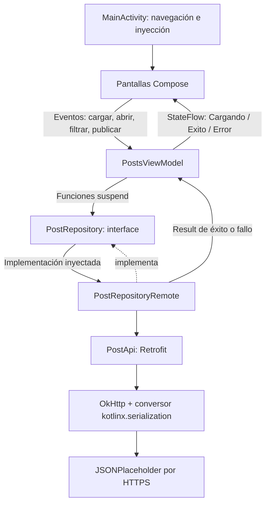
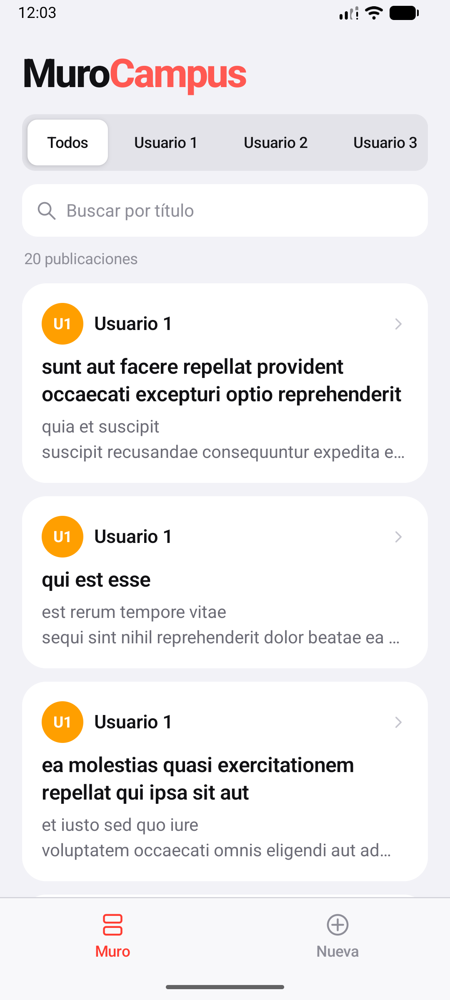
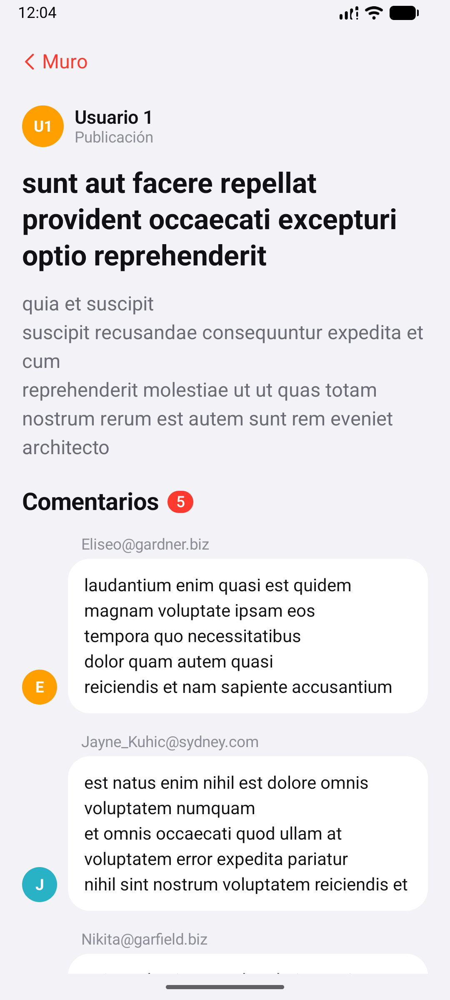
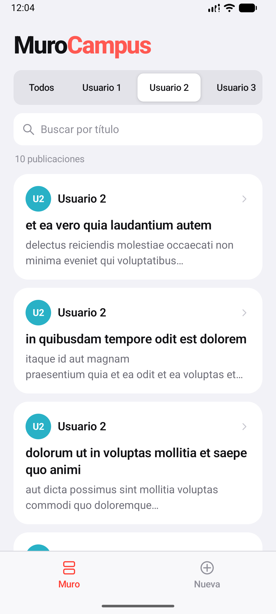
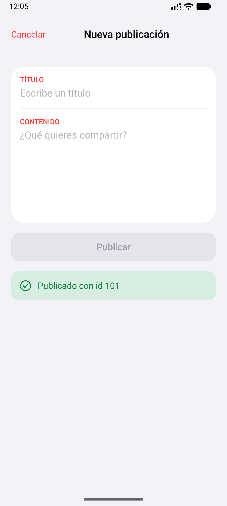
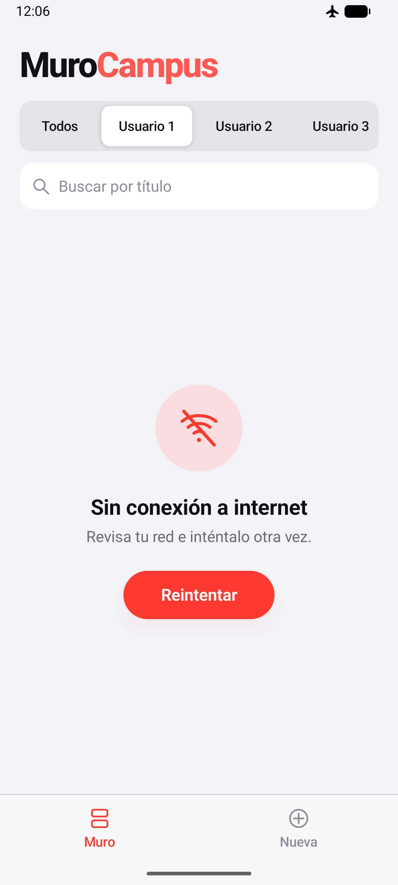

# MuroCampus

**Autor:** Fabian Ramirez  
**Curso:** Programación en Móviles - Semana 09  
**Paquete:** `com.ramirez.murocampus`

Aplicación Android con Kotlin y Jetpack Compose que consume el servicio REST de JSONPlaceholder. Permite listar publicaciones, consultar su detalle y comentarios, filtrar por usuario y enviar una publicación nueva. Cada operación muestra estados de carga, éxito y error, con opción de reintento.

JSONPlaceholder es un servicio de práctica: devuelve un ID al crear una publicación, pero no la guarda. Por eso una publicación enviada no aparece al recargar la lista.

## Ejecución

1. Abrir la carpeta `Semana09` en Android Studio y sincronizar Gradle.
2. Seleccionar un dispositivo o emulador con Android API 24 o superior e internet.
3. Ejecutar el módulo `app`.

La plantilla utiliza compileSdk/targetSdk 37. Las versiones de Gradle y dependencias están en `gradle/wrapper/gradle-wrapper.properties` y `gradle/libs.versions.toml`.

Desde PowerShell, con un JDK compatible configurado:

```powershell
.\gradlew.bat :app:assembleDebug
.\gradlew.bat :app:lintDebug
```

El permiso `INTERNET` está declarado antes de `<application>`. La URL base usa HTTPS y termina en `/`. El interceptor registra el cuerpo HTTP solo en compilaciones de desarrollo.

## Estructura de paquetes

```text
app/src/main/java/com/ramirez/murocampus/
├── MainActivity.kt
├── model/
│   └── Modelos.kt                 # Usuario, Post, Comentario y NuevoPost
├── data/
│   ├── Errores.kt                 # Traducción de errores a mensajes
│   ├── PostRepository.kt         # Contrato e implementación remota
│   ├── UsuarioRepository.kt      # Ejemplo de la base
│   └── remote/
│       ├── PostApi.kt
│       ├── RetrofitClient.kt
│       ├── UsuarioApi.kt
│       └── UsuarioRemote.kt
├── viewmodel/
│   ├── PostsViewModel.kt          # Lista, detalle, filtro y publicación
│   ├── PostsViewModelFactory.kt
│   ├── UiState.kt
│   └── UsuariosViewModel.kt       # Ejemplo de la base
└── ui/
    ├── Componentes.kt
    ├── Iconos.kt                  # Iconos propios dibujados como composables
    ├── PantallaLista.kt
    ├── PantallaDetalle.kt
    ├── PantallaCrear.kt
    ├── EjemploUsuarios.kt
    └── theme/
        ├── Color.kt
        ├── Theme.kt
        └── Type.kt

docs/capturas/                     # Cinco capturas reales del emulador
```

## Arquitectura MVVM + Repository



- Las pantallas observan `StateFlow` mediante `collectAsStateWithLifecycle()` y dibujan el estado con `when`.
- El ViewModel usa `viewModelScope` y conoce el contrato `PostRepository`; no importa Retrofit, `PostApi`, `HttpException` ni `Context`.
- El Repository captura las excepciones de operación y devuelve `Result`. La cancelación se relanza para detener el trabajo cuando corresponde.
- `mensajeDe`, ubicado en `data`, traduce errores de conexión, HTTP y serialización.
- `MainActivity` construye la factory y coordina las pantallas. Ningún Composable llama directamente a la API.
- Atrás cancela la carga del detalle y vuelve a la lista conservada en el ViewModel. Cambiar de filtro cancela la petición anterior.

## Servicio REST

Base: `https://jsonplaceholder.typicode.com/`

| Operación | Método y ruta | Respuesta |
| --- | --- | --- |
| Listar | `GET posts` | 100 publicaciones |
| Detalle | `GET posts/{id}` | Una publicación |
| Comentarios | `GET posts/{id}/comments` | 5 comentarios por publicación |
| Filtrar | `GET posts?userId=N` | 10 publicaciones del usuario elegido |
| Crear | `POST posts` con `NuevoPost` en el cuerpo | Publicación con ID 101 |

`NuevoPost` contiene `userId`, `title` y `body`; no envía `id`. El formulario utiliza `userId = 1`, impide envíos vacíos o repetidos mientras carga, limpia los campos al tener éxito y conserva el contenido cuando hay error.

## Capturas

Capturas reales del emulador Medium Phone con el rediseño coral, sin modificar las imágenes.

| Lista | Detalle con comentarios | Filtro por Usuario 2 |
| --- | --- | --- |
|  |  |  |

| Crear publicación | Error de conexión |
| --- | --- |
|  |  |

## Verificación de la Fase 1

Validación realizada el 25 de noviembre de 2026 en Medium Phone, API 37. Compilación y lint aprobados durante la implementación. La ejecución instrumentada temporal terminó con **5 pruebas, 0 fallos y 0 errores**: una prueba de contexto de la plantilla y cuatro pruebas de validación del laboratorio.

| Prueba | Comprobación realizada | Resultado |
| --- | --- | --- |
| Sin internet | Modo avión y Wi-Fi desactivado; apertura de la app | Mensaje de conexión y botón Reintentar, sin cierre |
| Reintentar | Restaurar conexión y pulsar Reintentar | Se recuperó la lista del usuario seleccionado |
| Recurso inexistente | Llamada real a `detalle(9999)` desde prueba temporal | Fallo HTTP 404 y mensaje `Error del servidor (404)` |
| JSON inesperado | Deserializar JSON con un campo extra y luego sin `body` obligatorio | Campo extra ignorado; campo faltante produce `Respuesta inesperada` |
| Cancelación | Abrir detalle y volver rápido; prueba temporal de cancelación del Repository | Retorno a lista sin error de AndroidRuntime; cancelación propagada |
| Lista y detalle | Listar y consultar publicaciones 1, 50 y 100 | 100 publicaciones; cada detalle devuelve 5 comentarios asociados |
| Filtro | Consultar cada usuario del 1 al 10 y revisar todos los `userId` | 10 publicaciones por usuario; filtro visual comprobado con Usuario 2 |
| Crear | Envío real de prueba y formulario de la app | ID 101; campos limpios después del éxito |
| Validación del formulario | Abrir el formulario vacío | Publicar deshabilitado |
| Error al crear | Enviar sin conexión | Mensaje de error; título y contenido conservados |
| Código | Revisión de imports del ViewModel y flujo de llamadas | Sin Retrofit, PostApi, HttpException ni Context en el ViewModel |

La prueba temporal comprobó el 404 y los cambios del JSON de forma aislada, sin cambiar las rutas ni los modelos de producción. Se retiró su código antes de preparar este commit de documentación. Tampoco quedan las llamadas temporales de `MainActivity`. Las opciones de red del emulador se restauraron después de la prueba sin internet.

Para repetir manualmente: probar la lista con internet, consultar un detalle, volver con Atrás, elegir un usuario, publicar desde **+**, y abrir la app sin conexión antes de probar Reintentar.

## Para pensar

### 1. ¿Qué diferencia hay entre GET y POST? ¿Por qué crear lleva @Body y porUsuario lleva @Query?

GET obtiene recursos; POST envía datos para crear un recurso. `crear` usa `@Body` porque envía los campos de `NuevoPost` como JSON en el cuerpo HTTP. `porUsuario` usa `@Query` porque el usuario es un criterio de consulta: `posts?userId=2`.

### 2. ¿Por qué la ruta es "posts" y no "/posts"?

`posts` se resuelve respecto al camino de la URL base. Una ruta que empieza con `/` se resuelve desde la raíz del servidor y descarta el camino que pudiera tener la base. Con la base actual, situada en la raíz, ambas pueden llegar al mismo recurso, pero usar la ruta relativa conserva el comportamiento correcto si la base cambia, por ejemplo a `/api/`.

### 3. ¿Por qué el Repository devuelve Result en vez de dejar que la excepción llegue al ViewModel?

El Repository concentra el acceso a datos y transforma los fallos de operación en un resultado explícito. El ViewModel procesa `onSuccess` y `onFailure` y los convierte en estados de pantalla. Así no depende de Retrofit ni de sus excepciones y puede trabajar con otra fuente de datos. `CancellationException` es la excepción a esta captura: se relanza para respetar la cancelación de la corrutina.

### 4. ¿Qué pasa si olvidas el permiso INTERNET? ¿Y si olvidas ignoreUnknownKeys y el servidor agrega un campo nuevo?

Sin `INTERNET`, Android no permite las conexiones de red de la app, aunque el dispositivo tenga acceso a internet. Sin `ignoreUnknownKeys = true`, un campo JSON desconocido puede provocar un fallo de serialización. La opción permite ignorar campos adicionales, pero no resuelve la ausencia de propiedades obligatorias ni tipos incompatibles.

### 5. ¿Por qué la pantalla de lista usa un when sobre UiState y no un if con tres variables?

`UiState` representa un único estado a la vez: carga, éxito o error. Con tres variables independientes podrían aparecer combinaciones contradictorias, como mostrar carga y éxito simultáneamente. El `when` sobre la interfaz sellada obliga a contemplar los estados y permite usar los datos que corresponden a cada uno.

### 6. JSONPlaceholder no guarda los POST. ¿Cómo cambiaría tu app si usaras un servicio real?

La publicación quedaría persistida y debería aparecer en futuras consultas. Después del éxito actualizaría la lista con el recurso devuelto o la recargaría. Usaría el ID real asignado por el servidor y manejaría sus errores de validación y, si el servicio lo requiere, autenticación. Mantendría los estados y la separación entre pantalla, ViewModel y Repository.

## Historial y alcance

La Fase 1 se desarrolla en `main`, con un commit por paso. La base se creó en tres commits previos porque no se entregó un proyecto inicial; el detalle está en [BASE.md](BASE.md). El permiso y las dependencias necesarios para el ejemplo de Usuario quedaron incluidos desde esa preparación y se revisaron en el paso 1.

## Fase 2 - Rama mejora-ia-sem9

La Fase 1 queda conservada en `main`. Por indicación del usuario, la Fase 2 usa la rama `mejora-ia-sem9`.

| Mejora | Estado |
| --- | --- |
| Eliminar publicación con DELETE y verificación del código HTTP | Implementada y verificada |
| Búsqueda por título en los datos descargados | Implementada y verificada |
| Paginación de 20 en 20 y botón Cargar más | Implementada y verificada |

En el detalle, **Eliminar** muestra carga, éxito o error con reintento. Al confirmarse el éxito HTTP, se retira la publicación de la lista local. JSONPlaceholder simula la operación, por lo que puede reaparecer al volver a descargar los datos.

**Buscar por título** filtra únicamente las publicaciones ya cargadas, sin hacer peticiones nuevas. Ignora mayúsculas y espacios al inicio y al final. **Limpiar** restaura las filas descargadas. La búsqueda se mantiene al cambiar de usuario y también se aplica a las páginas nuevas; una lista sin coincidencias todavía permite Cargar más.

La lista inicia con **20 publicaciones**. **Cargar más** solicita la siguiente página y la agrega a las anteriores mediante `GET posts?_start=N&_limit=20`, añadiendo `userId` cuando se filtra. Cambiar de usuario reinicia el cursor. Si falla una página adicional, las filas previas se conservan y Reintentar vuelve a solicitar el mismo inicio. El cursor cuenta los recursos recibidos del servidor, por lo que buscar o eliminar no hace saltar publicaciones.

El botón deja de aparecer cuando llega una página con menos de 20 elementos. Si el total es múltiplo de 20, se detecta el final con una petición adicional vacía. Por ejemplo, para las 100 publicaciones del servicio se cargan cinco bloques de 20 y una consulta vacía confirma el final. Al filtrar por usuario, sus 10 publicaciones caben en una página.

Rutas añadidas en esta fase:

| Operación | Método y ruta | Contrato |
| --- | --- | --- |
| Eliminar | `DELETE posts/{id}` | API: Response&lt;Unit&gt;; Repository: Result&lt;Unit&gt; |
| Paginar | `GET posts?_start=N&_limit=20&userId=U` | Lista de publicaciones; userId opcional |

Verificación de las mejoras:

```powershell
.\gradlew.bat :app:assembleDebug :app:testDebugUnitTest :app:lintDebug
```

Compilación y lint correctos. **12 pruebas unitarias aprobadas:** una de la plantilla, tres de eliminación y ocho de integración del ViewModel (búsqueda, paginación, errores, cancelación de filtros, fin de datos y eliminación sin desplazar el cursor). Los archivos de prueba están en `app/src/test/java/com/ramirez/murocampus/`.

Comprobación adicional en el emulador con el servicio real: inicio con 20 publicaciones; búsqueda sin coincidencias conservando esas 20; Cargar más eleva el contador a 40; buscar `sunt` devuelve títulos coincidentes; eliminar la publicación 1 muestra éxito y deja 39 filas cargadas; cambiar a Usuario 2 carga sus 10 publicaciones desde el inicio.

Las cinco capturas anteriores muestran el diseño actual de esta rama. La versión inicial queda conservada en `main`. Las tres mejoras se prepararon juntas por petición del usuario y el historial se organiza en tres commits: eliminación, búsqueda y paginación. Cada uno se comprobó con compilación y pruebas antes de registrarlo; el conjunto también pasó lint.

El análisis y las decisiones de asistencia de IA se documentan en [PROMPTS.md](PROMPTS.md).

## Diseño visual

El tema utiliza una paleta fija basada en las referencias del usuario: fondo `#F2F2F7`, tarjetas blancas, acento coral `#FF3B30`, marca coral `#FF5952` y grises para el texto secundario. No se aplican los colores dinámicos del dispositivo ni la paleta azul/morada de la plantilla. La tipografía sans serif usa títulos de 26 a 36 sp y texto principal de 16 a 18 sp.

El menú inferior Muro/Nueva, las tarjetas con avatar, los comentarios en burbujas, el formulario y los mensajes de éxito/error comparten estos estilos. `ui/Iconos.kt` contiene composables dibujados con Canvas, incluidos `IconoMuro`, `IconoNueva` e `IconoSinConexion`; se reutilizan en las pantallas. No se dibujan barras de desplazamiento.

El rediseño conserva búsqueda, paginación, creación y eliminación. Se comprobó la navegación, el POST con id 101 y el estado sin conexión en el emulador; la conexión se restauró después de la prueba. Compilación, lint y las 12 pruebas unitarias aprobados.
