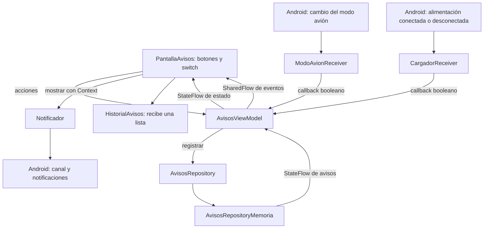
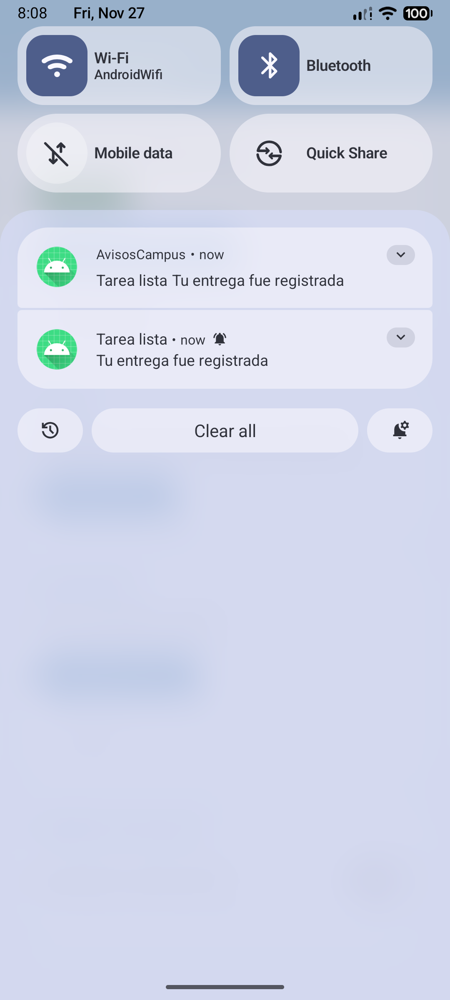
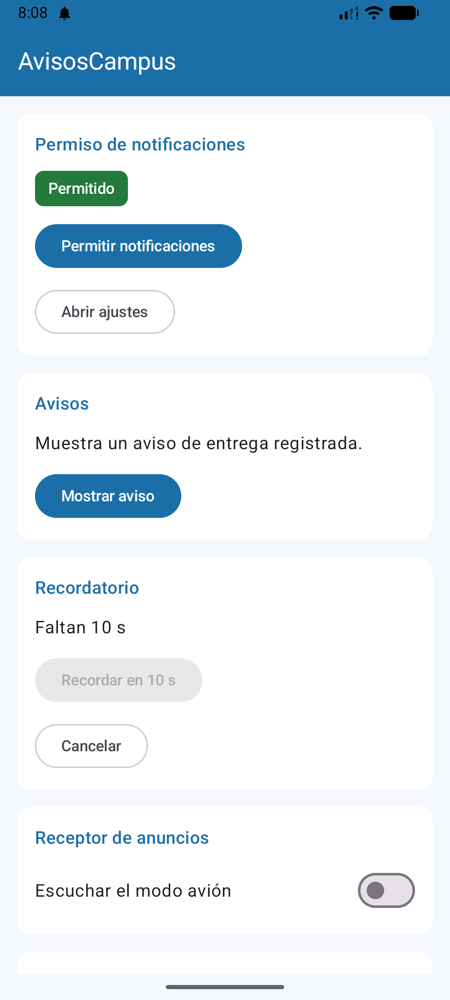
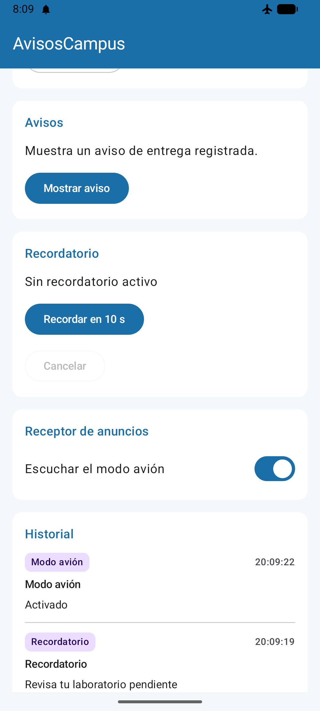
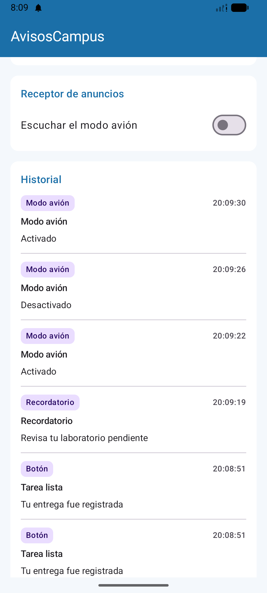
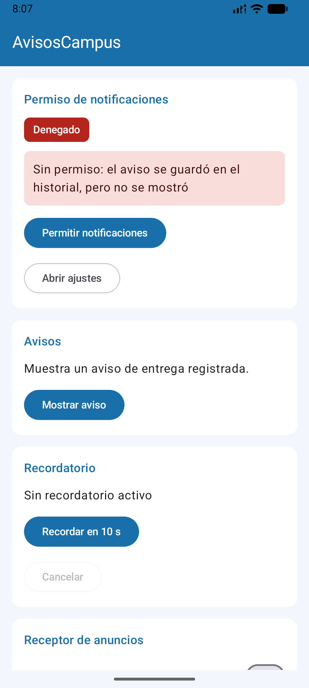

# AvisosCampus - Semana 15

Aplicación de notificaciones locales en Kotlin, Jetpack Compose y Material 3. Permite mostrar un aviso de entrega, programar un recordatorio de 10 segundos, escuchar cambios del modo avión y consultar los 20 avisos más recientes.

El proyecto usa MVVM y Repository, sin pantallas XML, servicios remotos ni claves. Todos los mensajes son ficticios. El historial vive en memoria: sobrevive a la recreación de la Activity, pero se pierde al terminar el proceso.

## Ejecutar

1. Abrir la carpeta `Semana15` en Android Studio.
2. Sincronizar Gradle y seleccionar un emulador Android API 33 o superior para probar el permiso de notificaciones.
3. Ejecutar el módulo `app` y pulsar **Permitir notificaciones**.
4. En **Avisos**, probar **Mostrar aviso**, **Recordar en 10 s** y **Cancelar**. En **Receptores**, activar las escuchas del modo avión o del cargador. En **Historial**, consultar los avisos generados.

La app admite desde API 24; en versiones anteriores a API 33 no aparece el diálogo de `POST_NOTIFICATIONS`. El canal `avisos` se crea desde `AvisosApp` al iniciar, en API 26 o superior. **Abrir ajustes** lleva a la configuración de notificaciones; tras conceder el permiso allí, volver y pulsar **Permitir notificaciones** actualiza la etiqueta y limpia el error.

```powershell
.\gradlew.bat :app:assembleDebug :app:lintDebug
```

## Estructura de paquetes

```text
app/src/main/java/com/ramirez/avisoscampus/
├── AvisosApp.kt
├── MainActivity.kt
├── model/
│   └── Modelos.kt
├── data/
│   └── AvisosRepository.kt
├── notificacion/
│   └── Notificador.kt
├── receiver/
│   ├── ModoAvionReceiver.kt
│   └── CargadorReceiver.kt
├── viewmodel/
│   ├── AvisosViewModel.kt
│   └── AvisosViewModelFactory.kt
└── ui/
    ├── PantallaAvisos.kt
    ├── HistorialAvisos.kt
    └── theme/

app/src/main/res/drawable/ic_notificacion.xml
app/src/androidTest/java/com/ramirez/avisoscampus/
├── AceptacionTest.kt
├── CargadorTest.kt
└── MejorasNotificacionTest.kt
docs/capturas/
```

## Arquitectura MVVM + Repository



- **View:** solicita el permiso, observa los flujos, recibe eventos y llama al Notificador. Registra el receptor con `RECEIVER_NOT_EXPORTED` y lo retira en `onDispose`.
- **ViewModel:** decide el contenido de cada aviso y lo registra antes de emitirlo. Gestiona la cuenta regresiva con `viewModelScope`, `Job` y `delay`; `finally` limpia el estado al terminar o cancelar. No usa `Context`, `NotificationManager` ni `BroadcastReceiver`.
- **Repository:** expone la interfaz del historial y genera IDs consecutivos y la hora. Inserta primero el aviso más reciente.
- **Notificador:** comprueba el permiso y construye la notificación con su ícono, título, texto, ID propio, `PendingIntent.FLAG_IMMUTABLE` y `setAutoCancel(true)`.

## Capturas

Capturas reales del emulador, obtenidas durante las pruebas instrumentadas de la fase 1.

### Notificación en el panel



### Cuenta regresiva del recordatorio



### Cambio del modo avión



### Historial



### Permiso denegado



## Pruebas de aceptación

Entorno: emulador Medium Phone, Android 17, API 37. Las pruebas instrumentadas usan la Activity real, los controles Compose, el Repository en memoria y el sistema de notificaciones. El caso sin permiso requiere preparar la denegación antes de iniciar su proceso de prueba; esto evita que la revocación mate una prueba ya en ejecución.

| Prueba | Estado y evidencia |
| --- | --- |
| Canal Avisos existente | Verificado previamente con `dumpsys notification`; revisión automática en la suite. |
| Diálogo y estado del permiso | Diálogo observado y aceptación confirmada por el usuario durante el paso 2. |
| Mostrar Tarea lista | Verificado durante el paso 3; revisión automática en la suite. |
| Dos notificaciones con IDs distintos | Verificado durante el paso 3; revisión automática en la suite. |
| Tocar una notificación | OK en segundo plano y con el proceso terminado: abre MainActivity y retira el aviso. |
| Recordatorio con cuenta regresiva | OK: se muestra la cuenta, se deshabilita iniciar y se habilita Cancelar. |
| Recordatorio con app minimizada | OK: aparece la notificación Recordatorio tras los 10 segundos. |
| Cancelar sin emitir aviso | OK: transcurridos más de 10 segundos no se registra un aviso nuevo. |
| Modo avión con switch activo | OK: los cambios reales del sistema generan Activado y Desactivado. |
| Modo avión con switch apagado | OK: cambiar el modo avión no incrementa el historial. |
| Permiso denegado: historial y error sin cierre | OK: se conserva el aviso y se muestra el mensaje. Abrir ajustes abre `com.android.settings`. |
| Rotar durante el recordatorio | OK: se cambia la orientación a horizontal y luego a vertical; se conserva el ViewModel y la cuenta continúa. |
| Receptor después de recrear Activity | OK: conserva el switch y recibe otro cambio del modo avión. |
| Capas MVVM y retirada del receptor | Revisado en el código; el registro tiene su `unregisterReceiver` en `onDispose`. |

Las dos suites instrumentadas se verificaron en el emulador. La apertura desde segundo plano también se comprobó durante el paso 4. Para verificar el proceso terminado se dejó un único aviso, se cerró el proceso con `am kill`, se comprobó que `pidof` no devolvía un PID y se tocó la notificación desde el panel de Android: se inició un nuevo proceso y el aviso desapareció.

Resultados guardados: [suite con permiso](docs/pruebas/aceptacion-con-permiso.txt) y [suite sin permiso](docs/pruebas/aceptacion-sin-permiso.txt), ambas con `OK (1 test)`.

La compilación y Android Lint terminan correctamente. Lint conserva advertencias sobre versiones, recursos sin usar y comprobaciones antiguas de Lifecycle que no puede cargar; la separación de capas y la retirada del receptor se revisaron también directamente en el código.

### Repetir las pruebas instrumentadas

Usar un emulador dedicado API 33+, con `adb` en el PATH. La suite cambia el modo avión y lo restaura en `finally`. La denegación del permiso se prepara antes de lanzar la segunda suite, porque revocarlo mientras se ejecuta la instrumentación termina su proceso. Los comandos finales restauran el permiso para seguir usando la app.

```powershell
.\gradlew.bat :app:assembleDebug :app:assembleDebugAndroidTest
adb install -r -t app/build/outputs/apk/debug/app-debug.apk
adb install -r -t app/build/outputs/apk/androidTest/debug/app-debug-androidTest.apk

adb shell pm grant com.ramirez.avisoscampus android.permission.POST_NOTIFICATIONS
adb shell am instrument -w -r -e class com.ramirez.avisoscampus.AceptacionConPermisoTest com.ramirez.avisoscampus.test/androidx.test.runner.AndroidJUnitRunner

adb shell pm revoke com.ramirez.avisoscampus android.permission.POST_NOTIFICATIONS
adb shell pm set-permission-flags com.ramirez.avisoscampus android.permission.POST_NOTIFICATIONS user-set user-fixed
adb shell am instrument -w -r -e class com.ramirez.avisoscampus.AceptacionSinPermisoTest com.ramirez.avisoscampus.test/androidx.test.runner.AndroidJUnitRunner

adb shell pm clear-permission-flags com.ramirez.avisoscampus android.permission.POST_NOTIFICATIONS user-fixed
adb shell pm grant com.ramirez.avisoscampus android.permission.POST_NOTIFICATIONS
adb pull /sdcard/Android/data/com.ramirez.avisoscampus/files/capturas docs/
```

## Para pensar

1. **¿Por qué hacen falta un canal y un permiso?** Desde Android 8, el canal organiza las notificaciones y permite al usuario controlar su importancia, sonido y visibilidad. Desde Android 13, `POST_NOTIFICATIONS` autoriza mostrarlas. Sin un canal válido en API 26+, la notificación no se publica; sin permiso en API 33+, esta app devuelve `false`, conserva el aviso en el historial y explica por qué no se mostró.
2. **¿Por qué el ViewModel emite un evento?** Decide qué avisar sin depender de Android. La pantalla recibe el evento y usa su `Context` para llamar al Notificador. Así se separan estado, decisiones y acceso al sistema, y el ViewModel puede probarse de forma aislada.
3. **¿Qué ocurre al reutilizar un ID?** Con la misma app y etiqueta, una nueva llamada a `notify` con el mismo ID actualiza o reemplaza la notificación anterior. Esta app usa el ID consecutivo del aviso para mantener varias notificaciones simultáneas.
4. **¿Por qué `onReceive` debe ser corto y hay que retirar el receptor?** El callback tiene un tiempo de ejecución limitado y no es el lugar para tareas largas. Aquí solo valida la acción y entrega un booleano. Retirarlo evita conservar referencias a una Activity destruida, duplicar escuchas o recibir eventos cuando la función está desactivada.
5. **¿Cuándo usar notificaciones locales o push de Firebase?** Las locales sirven para eventos conocidos por el dispositivo, como una entrega simulada, un recordatorio o el modo avión; no necesitan servidor. Push sirve cuando el evento nace fuera del dispositivo, como un anuncio nuevo del campus o un mensaje enviado por un servicio remoto. Esta fase usa solamente notificaciones locales.

## Historial de la fase 1

Como no se recibió el proyecto base, se preparó en tres commits adicionales antes de los diez de la guía. La fase 1 está en `main`; la fase 2 se desarrolla en `mejora-ia-sem15`.

| N.º PDF | Mensaje |
| --- | --- |
| 1 | `chore: importa proyecto base AvisosCampus` |
| 2 | `feat(notificacion): crea el canal Avisos en la clase Application` |
| 3 | `feat(permiso): pide POST_NOTIFICATIONS y muestra su estado` |
| 4 | `feat(notificacion): muestra la notificacion con NotificationCompat` |
| 5 | `feat(notificacion): abre la app al tocar con PendingIntent` |
| 6 | `feat(recordatorio): cuenta regresiva con corrutina y cancelacion` |
| 7 | `feat(receptor): escucha el modo avion con BroadcastReceiver` |
| 8 | `feat(ui): agrega historial de avisos` |
| 9 | `feat(errores): maneja el permiso de notificaciones denegado` |
| 10 | `docs: agrega README con estructura y capturas` |

## Fase 2 - Mejoras

1. **Texto expandible:** todas las notificaciones usan `BigTextStyle` con el texto completo del aviso. Los mensajes breves de la fase 1 se conservan; la prueba `MejorasNotificacionTest` publica un texto largo para comprobar el contenido expandido.
2. **Dos canales:** `avisos` conserva importancia predeterminada y `urgentes` usa importancia alta. El Notificador envía los avisos de origen Recordatorio al canal Urgentes, manteniendo Avisos para los demás. En API 24 y 25 se utiliza prioridad alta para los recordatorios. La ventana emergente puede depender de No molestar y de los ajustes del usuario; recrear el canal no sobrescribe sus preferencias.
3. **Receptor del cargador:** una tarjeta con el switch **Escuchar el cargador** activa la escucha de conexión y desconexión de la alimentación. Cada cambio genera un aviso Cargador / Conectado o Desconectado, por el canal Avisos y con origen propio en el historial. El switch empieza apagado y su estado se conserva al recrear la Activity. Tiene su propio `DisposableEffect` y `unregisterReceiver`; el ViewModel solo recibe un booleano.

Las pruebas `MejorasNotificacionTest` y `CargadorTest` comprueban el contenido expandido, la selección de canales y la escucha del cargador. Esta última utiliza `dumpsys battery` en un emulador dedicado y restaura la batería con `reset` al terminar. La suite de aceptación de la fase 1 identifica cada switch por su descripción accesible para distinguir las dos funciones.

El registro de la asistencia y las decisiones está en [PROMPTS.md](PROMPTS.md).

Validación en el emulador API 37: compilación y Lint correctos; **4 pruebas instrumentadas aprobadas**, incluyendo la regresión de la fase 1. [Resultado completo](docs/pruebas/fase2-mejoras.txt).

Para ejecutar las pruebas de las mejoras y la regresión de la fase 1 después de instalar los APK de depuración y de pruebas, con el permiso de notificaciones concedido:

```powershell
adb shell am instrument -w -r -e class "com.ramirez.avisoscampus.MejorasNotificacionTest,com.ramirez.avisoscampus.CargadorTest,com.ramirez.avisoscampus.AceptacionConPermisoTest" com.ramirez.avisoscampus.test/androidx.test.runner.AndroidJUnitRunner
```

## Diseño y navegación nativos

La interfaz sigue las referencias de AvisosCampus: fondo gris claro, tarjetas blancas redondeadas, botones coral, indicadores verdes y cuenta regresiva turquesa. Todo se construye con las dependencias de Kotlin y Compose existentes, sin fuentes, imágenes ni bibliotecas de iconos externas.

- `IconosCampus.kt`: vectores propios de Compose, reutilizados en tarjetas y menú.
- `ComponentesCampus.kt` y `TarjetasCampus.kt`: tarjetas, botones, etiquetas y switches con un estilo común.
- `theme/`: escala tipográfica completa con fuente nativa del sistema, tamaños de lectura de 16-17 sp, títulos de 32 sp y colores explícitos. Se conserva el tema claro de la referencia aunque el dispositivo esté en modo oscuro.
- `NavegacionCampus.kt`: menú inferior accesible con las secciones Avisos, Receptores e Historial. Cada sección conserva su desplazamiento; la selección se guarda al recrear la Activity y Atrás vuelve a Avisos.
- `PantallaAvisos.kt`: mantiene eventos y receptores fuera del contenido de las pestañas, de modo que cambiar de sección no interrumpe las funciones. Cuando el recordatorio está activo se muestra primero, con progreso y segundos restantes.

`DisenoNavegacionTest` verifica el cambio de secciones, la selección tras recrear la pantalla, el botón Atrás, los receptores activos entre secciones y la finalización del recordatorio mientras se consulta otra pestaña.

Verificado en el emulador: compilación y Lint sin errores; [5 pruebas de regresión y navegación aprobadas](docs/pruebas/rediseno-regresion.txt) y [1 prueba de permiso denegado aprobada](docs/pruebas/rediseno-sin-permiso.txt).

Capturas actuales: [Avisos](docs/capturas/rediseno/01-avisos.png), [Receptores](docs/capturas/rediseno/02-receptores.png), [Historial](docs/capturas/rediseno/03-historial.png), [recordatorio activo](docs/capturas/rediseno/04-recordatorio-activo.png) y [permiso denegado](docs/capturas/rediseno/05-permiso-denegado.png).

## Referencias

- [Notificaciones de Android](https://developer.android.com/develop/ui/views/notifications)
- [Permiso de notificaciones](https://developer.android.com/develop/ui/views/notifications/notification-permission)
- [Pruebas de interfaces Compose](https://developer.android.com/develop/ui/compose/testing/apis)
- [Notificaciones expandibles](https://developer.android.com/develop/ui/compose/notifications/expanded)
- [Canales de notificación](https://developer.android.com/develop/ui/compose/notifications/channels)
- [Estado de carga y alimentación](https://developer.android.com/training/monitoring-device-state/battery-monitoring)
- [AndroidX Test: notas de versión](https://developer.android.com/jetpack/androidx/releases/test). Espresso 3.7.0 corrige el uso de `InputManager.getInstance` que impedía iniciar las pruebas con la versión anterior en este emulador.
